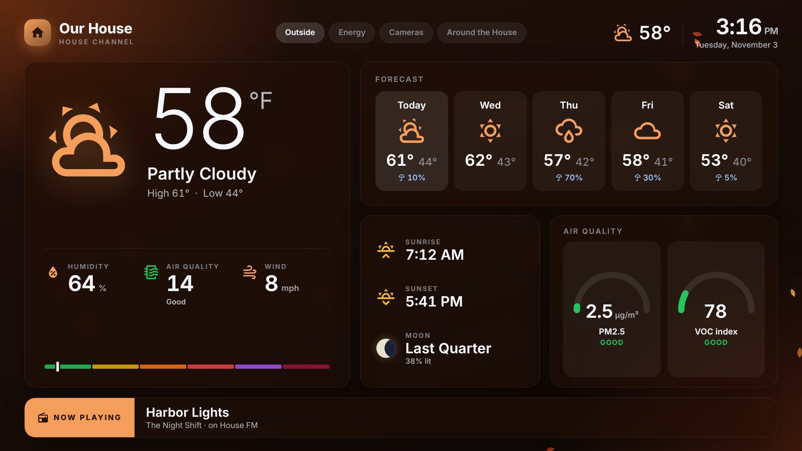
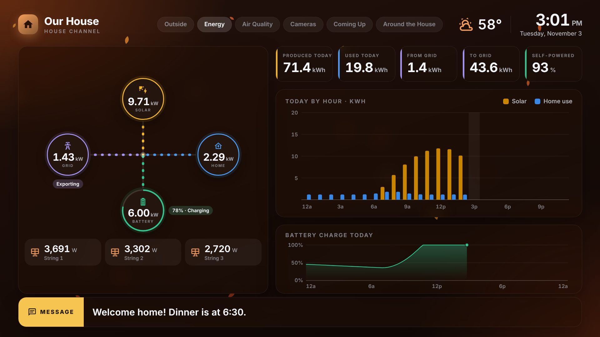
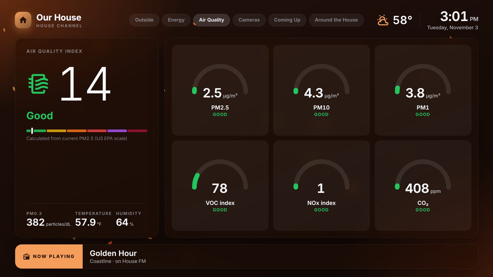
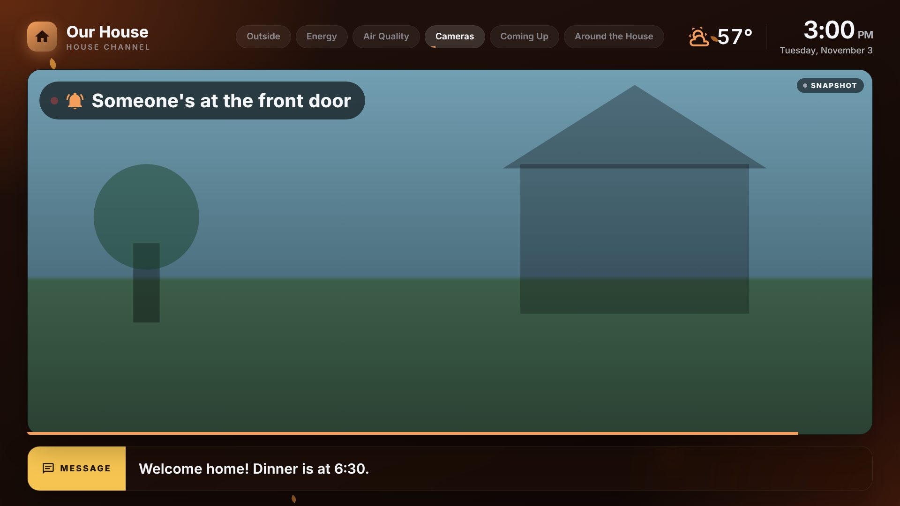

# House TV

A "house channel" for your TVs, like the ship channel on a cruise. A Raspberry
Pi plugs into HDMI (or a QAM modulator) and rotates through screens of live
Home Assistant data:

- **Outside:** current conditions, forecast, sunrise/sunset, moon phase, and air quality gauges
  (e.g. PM2.5 and VOC from a local monitor)
- **Energy:** live solar / battery / grid / home power flow, plus today's totals and hourly
  chart read straight from your **Home Assistant Energy dashboard**
- **Air quality** (optional, more detail): up to six gauges for PM2.5 / PM10 / PM1 / PM0.3 / VOC / NOx / CO₂
- **Cameras:** up to four live feeds
- **Calendar** (optional) and a free-form **tiles** screen for anything else

It also has an always-on header (clock, weather), a lower third with **what's playing** on chosen
media players and a **message board**, a scrolling **alert** banner, **camera pop-ups** (e.g. when
the doorbell rings), **background music** from a folder of MP3s, and **seasonal themes** with
gentle animated effects (snow, falling leaves, petals, fireflies). Screens crossfade from one to
the next.

| Outside | Energy |
|---|---|
|  |  |
| **Air quality** | **Cameras + doorbell pop-up** |
|  |  |

*(Screenshots are from the built-in demo mode.)*

## How it works

```
Home Assistant ──WebSocket API──▶ house-tv server (Docker) ──web page──▶ Chromium kiosk ──HDMI──▶ TV / modulator
      ▲                                │
      └──────── MQTT discovery ◀───────┘   ("House TV" device: theme, screen, music, message…)
```

- **One small server** (Python, in Docker) talks to Home Assistant using only its public, long-stable
  APIs (WebSocket state updates, statistics/history, `camera/stream`, `weather.get_forecasts`).
  **Nothing is installed inside Home Assistant**, so HA upgrades are unlikely to break it.
- **The display is just a web page.** The Pi runs Chromium full screen pointed at the server. The
  same page works in any browser, which helps when tuning the layout from a laptop.
- **Home Assistant control is through MQTT discovery.** A "House TV" device appears in HA with
  entities for theme, current screen, next screen, music on/off, volume, skip track, message, and
  default screen time, so automations can drive the channel.
- **The layout lives in one YAML file** (`config/config.yaml`), reloaded automatically when saved.

## Hardware

| Pi | Verdict |
|---|---|
| **Raspberry Pi 5 (4 GB)** | **Recommended.** Plenty of headroom for 1080p, effects and four camera sub-streams. |
| Raspberry Pi 4 (2-4 GB) | Good. |
| Raspberry Pi 3B+ (1 GB) | Will run, but expect it to be sluggish. Set `display.effects: false` and cameras `mode: snapshot`. Four live video streams in a browser are too much for it. |

Use **Raspberry Pi OS Lite, 64-bit**. The image is published for `arm64` and `amd64`; any small
x86 mini-PC works too.

The server and the display can run on the same Pi (simplest), or the server can run on any
Docker host with one or more Pis just displaying the page.

## Try it in 1 minute (demo mode, no Home Assistant)

```bash
git clone https://github.com/duffduff99/HomeOverviewTV && cd HomeOverviewTV
pip install -r requirements.txt
python -m housetv --demo
```

Open <http://localhost:8080>. In demo mode, <http://localhost:8080/demo/doorbell>,
`/demo/alert`, `/demo/next` and `/demo/theme-winter` preview the pop-up, alert banner, rotation
and themes.

## Install on a Raspberry Pi

1. **Flash Raspberry Pi OS Lite (64-bit)** with Raspberry Pi Imager. Enable SSH and set a username.
2. **Install Docker:**
   ```bash
   curl -fsSL https://get.docker.com | sudo sh
   sudo usermod -aG docker $USER   # log out and back in afterwards
   ```
3. **Get House TV and configure it:**
   ```bash
   git clone https://github.com/duffduff99/HomeOverviewTV ~/house-tv && cd ~/house-tv
   cp .env.example .env               # set HA_URL, HA_TOKEN, MQTT_* here
   cp config/config.example.yaml config/config.yaml
   nano config/config.yaml            # put in your entity ids
   ```
   Create the token in Home Assistant under *your profile → Security → Long-lived access tokens*.
   To look up entity ids:
   ```bash
   docker compose run --rm house-tv entities solar
   ```
4. **Start the server:**
   ```bash
   docker compose up -d
   ```
   Check it from any browser at `http://<pi-address>:8080`.
5. **Turn the HDMI output into a kiosk:**
   ```bash
   sudo ./kiosk/install-kiosk.sh
   sudo reboot
   ```
   Options: `--url http://other-host:8080` if the server runs elsewhere, and `--force-1080p` if
   the modulator negotiates the wrong resolution. Logs: `journalctl -u house-tv-kiosk -f`.
6. **Add music:** copy MP3s (or m4a/ogg/flac) into `~/house-tv/music/`. New files are picked up
   within a minute, and audio goes out over HDMI.

### Updating

```bash
cd ~/house-tv && git pull && docker compose pull && docker compose up -d
```

## Configuration

Everything is in [`config/config.example.yaml`](config/config.example.yaml), with comments. The
highlights:

- **Screen time:** `rotation.default_duration`, or `duration:` on any screen (seconds). The
  "Default screen time" entity in HA changes the default live.
- **Conditional screens:** `show_when:`, e.g. only show the solar strings while
  `sun.sun` is `above_horizon`.
- **Energy:** today's kWh totals and the hourly chart come from the Energy dashboard
  automatically. For the live flow diagram, list your instantaneous power sensors under `power:`.
  Use `battery_invert` / `grid_invert` if your sensors use the opposite sign convention.
- **Air quality:** `air_gauges:` on the Outside screen (up to 4), or a separate `type: air` screen with up to 6 gauges. `kind:` (pm25, pm10, pm1, pm03, voc,
  nox, co2) picks the scale and health bands, and the band name is printed under each gauge.
- **Cameras:** for best results, point at your cameras' **sub-streams**. With the Generic Camera
  integration, add a second camera entity in HA whose stream URL is the sub-stream.
- **Transitions:** `display.transition_seconds` sets the crossfade length.
- **TV overscan:** if the edges are cut off, raise `display.safe_area` (percent).

## Themes

Built in: `night`, `autumn`, `winter`, `spring`, `summer`, `holiday`. Pick them by date with
`theme.schedule`, or from Home Assistant with the **Theme** select (choose *Auto* to go back to
the schedule).

To make your own, create `config/themes/<name>/theme.json`:

```json
{
  "name": "Lake House",
  "background_image": "background.jpg",
  "dim": 0.35,
  "particles": "snow",
  "colors": { "accent": "#8fd3ff", "accent-ink": "#04121c" }
}
```

Put `background.jpg` (or `background_video: "loop.mp4"`) next to it. `particles` can be `snow`,
`leaves`, `petals`, `fireflies`, `sparkles` or `none`. `dim` darkens the background so text stays
readable. Advanced users can add a `theme.css`.

## Home Assistant automations

The MQTT device gives you ordinary entities (names may differ slightly depending on your `name:`):

```yaml
# Pop the front-door camera up for 30 seconds when the doorbell rings
automation:
  - alias: Doorbell on House TV
    triggers:
      - trigger: state
        entity_id: binary_sensor.doorbell
        to: "on"
    actions:
      - action: mqtt.publish
        data:
          topic: house_tv/show_camera
          payload: '{"camera": "camera.front_door_sub", "title": "Someone is at the door", "duration": 30}'

  # Put a message on the channel
  - alias: Dinner message
    triggers:
      - trigger: time
        at: "17:45:00"
    actions:
      - action: text.set_value
        target:
          entity_id: text.our_house_tv_message
        data:
          value: "Dinner in 15 minutes!"
```

For simple cases, the `interrupts:` section in `config.yaml` does the doorbell pop-up without an
automation. It fires when the entity *changes to* the `to:` state (default `on`). Use
`to: changed` for event entities such as `event.front_doorbell`, which get a new timestamp on every
press. Publishing `{"camera": "none"}` to `house_tv/show_camera` dismisses a pop-up early.

**Alerts** (`alerts:` in `config.yaml`) show a scrolling banner for as long as the entity is active
(on, a non-zero number, or any text other than off/unknown/unavailable), and disappear when it
isn't. The text comes from `text:`, an attribute (`attribute:`), or the entity's name.

## Troubleshooting

- **"Waiting for Home Assistant…"**: check `HA_URL` is reachable from the Pi and the token is
  valid (`docker compose logs house-tv`).
- **Energy totals show "—"**: the Energy dashboard must be configured in HA. The server logs which
  statistics it found at startup.
- **Cameras show "SNAPSHOT" instead of "LIVE"**: HA couldn't provide a stream for that camera,
  so stills are refreshed instead. Make sure the camera has a stream URL in HA.
- **No sound**: confirm the modulator/TV accepts HDMI audio, and run `aplay -l` on the Pi. The
  kiosk script selects the first HDMI audio device.

## Development

```bash
pip install -r requirements.txt pytest
python -m pytest -q
python -m housetv --demo --port 8080
```

The front end is plain HTML/CSS/JavaScript modules with no build step, under `web/`. Each screen
is one file in `web/js/screens/`.

## License

MIT. Bundles [Inter](https://rsms.me/inter/) (SIL OFL 1.1),
[hls.js](https://github.com/video-dev/hls.js) (Apache 2.0) and icons from
[Material Design Icons](https://pictogrammers.com/library/mdi/) (Pictogrammers Free License; icons Apache 2.0).
