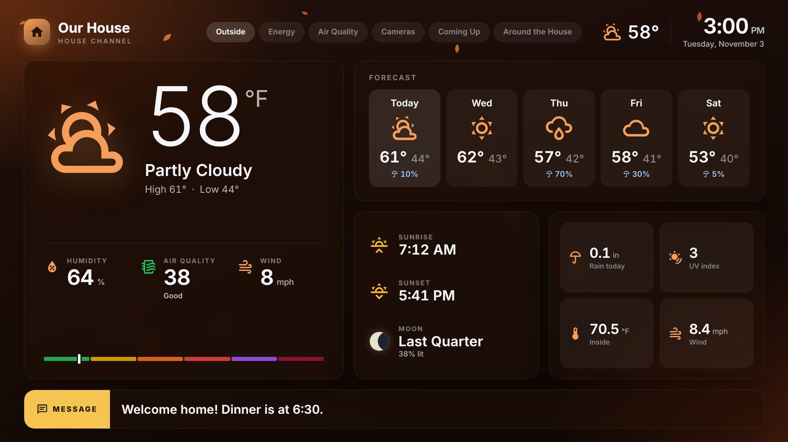
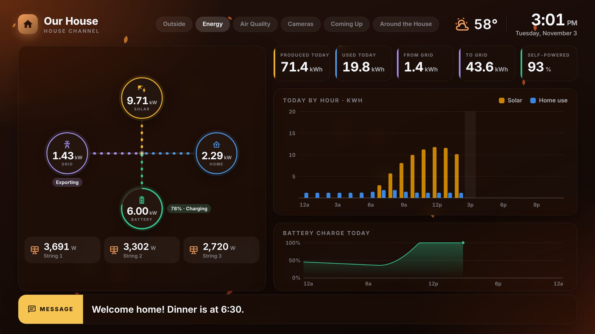
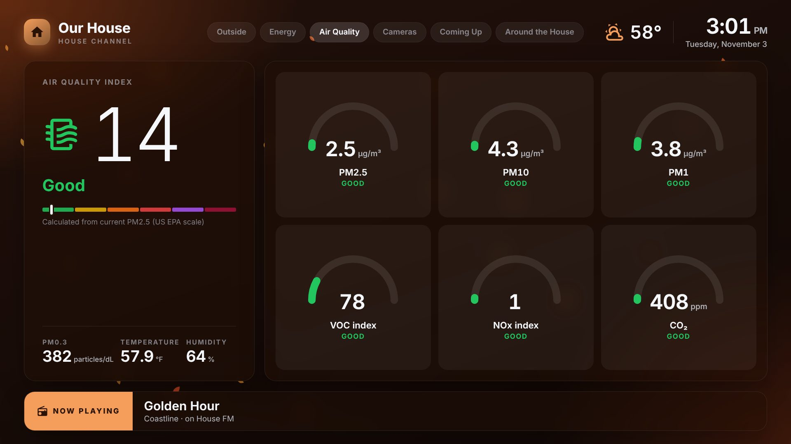
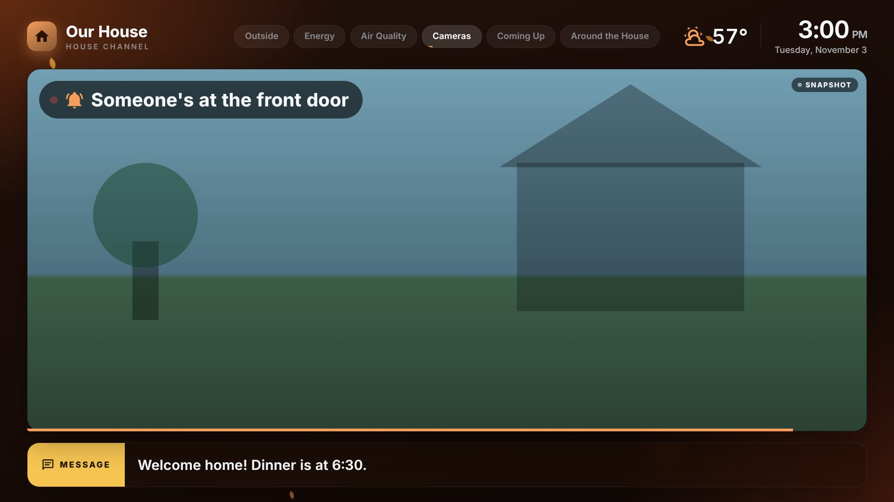

# House TV

A "house channel" for your TVs, like the ship channel on a cruise. A Raspberry
Pi plugs into HDMI (or a QAM modulator) and rotates through screens of live
Home Assistant data:

- **Outside:** current conditions, forecast, sunrise/sunset, moon phase, and up to six outdoor
  air quality gauges (PM2.5, PM10, VOC, NOx, CO₂… from a local monitor)
- **Inside:** thermostat mode, setpoint and what it's doing; room temperatures and humidity; ERV
  mode, running and boost; indoor air quality; optional duct temperatures and equipment power
- **Energy:** live solar / battery / grid / home power flow, plus today's totals and hourly
  chart read straight from your **Home Assistant Energy dashboard**
- **Air quality** (optional, more detail): up to six gauges for PM2.5 / PM10 / PM1 / PM0.3 / VOC / NOx / CO₂
- **Cameras:** up to four live feeds
- **Coming Up** (optional): calendar events by day, and to-do lists from Home Assistant
- **Headlines** (optional): top stories from AP, NPR and BBC (or feeds you choose), with
  Wikipedia's "On this day"
- A free-form **tiles** screen for anything else

It also has an always-on header (clock, weather), a lower third with **what's playing** on chosen
media players and a **message board**, a scrolling **alert** banner, **camera pop-ups** (e.g. when
the doorbell rings), **background music** from a folder of MP3s, and **seasonal themes** with
gentle animated effects (snow, falling leaves, petals, fireflies). Screens crossfade from one to
the next.

| Outside | Energy |
|---|---|
|  |  |
| **Air quality** | **Cameras + doorbell pop-up** |
|  |  |

*(Screenshots are from the built-in demo mode.)*

## How it works

```
Home Assistant ──WebSocket API──▶ house-tv server (Docker) ──web page──▶ Chromium kiosk ──HDMI──▶ TV / modulator
      ▲                                │
      └──────── MQTT discovery ◀───────┘   ("House TV" device: theme, screen, music, message…)
```

- **One small server** (Python, in Docker) talks to Home Assistant using only its public, long-stable
  APIs (WebSocket state updates, statistics/history, `camera/stream`, `weather.get_forecasts`).
  **Nothing is installed inside Home Assistant**, so HA upgrades are unlikely to break it.
- **The display is just a web page.** The Pi runs Chromium full screen pointed at the server. The
  same page works in any browser, which helps when tuning the layout from a laptop.
- **Home Assistant control is through MQTT discovery.** A "House TV" device appears in HA with
  entities for theme, current screen, next screen, music on/off, volume, skip track, message, and
  default screen time, so automations can drive the channel.
- **The layout lives in one YAML file** (`config/config.yaml`), reloaded automatically when saved.

## Hardware

| Pi | Verdict |
|---|---|
| **Raspberry Pi 5 (4 GB)** | **Recommended.** Plenty of headroom for 1080p, effects and four camera sub-streams. |
| Raspberry Pi 4 (2-4 GB) | Good. |
| Raspberry Pi 3B+ (1 GB) | Will run, but expect it to be sluggish. Set `display.effects: false` and cameras `mode: snapshot`. Four live video streams in a browser are too much for it. |

Use **Raspberry Pi OS Lite, 64-bit**. The image is published for `arm64` and `amd64`; any small
x86 mini-PC works too.

The server and the display can run on the same Pi (simplest), or the server can run on any
Docker host with one or more Pis just displaying the page.

## Try it in 1 minute (demo mode, no Home Assistant)

```bash
git clone https://github.com/duffduff99/HomeOverviewTV && cd HomeOverviewTV
python3 -m venv .venv                  # Ubuntu/Debian: sudo apt install python3-venv first
.venv/bin/pip install -r requirements.txt
.venv/bin/python -m housetv --demo
```

Or, with Docker and nothing else installed:

```bash
docker run --rm -p 8080:8080 -e DEMO=1 ghcr.io/duffduff99/homeoverviewtv:latest
```

Open <http://localhost:8080>. In demo mode, <http://localhost:8080/demo/doorbell>,
`/demo/alert`, `/demo/next` and `/demo/theme-winter` preview the pop-up, alert banner, rotation
and themes.

## Install on a Raspberry Pi

1. **Flash Raspberry Pi OS Lite (64-bit)** with Raspberry Pi Imager. Enable SSH and set a username.
2. **Install Docker:**
   ```bash
   curl -fsSL https://get.docker.com | sudo sh
   ```
   Optional: `sudo usermod -aG docker $USER` (then log out and back in) lets you run `docker`
   without `sudo`. Membership in the `docker` group is equivalent to root without a password, so
   follow whatever policy you use on your other servers. If you skip it, put `sudo` in front of
   the `docker compose` commands below.
3. **Get House TV and configure it:**
   ```bash
   git clone https://github.com/duffduff99/HomeOverviewTV ~/house-tv && cd ~/house-tv
   cp .env.example .env               # set HA_URL, HA_TOKEN, MQTT_* here
   cp config/config.example.yaml config/config.yaml
   nano config/config.yaml            # put in your entity ids
   ```
   Create the token in Home Assistant under *your profile → Security → Long-lived access tokens*.
   To look up entity ids:
   ```bash
   docker compose run --rm house-tv entities solar
   ```
4. **Start the server:**
   ```bash
   docker compose up -d
   ```
   Check it from any browser at `http://<pi-address>:8080`.
5. **Turn the video output into a kiosk:**
   ```bash
   sudo ./kiosk/install-kiosk.sh
   sudo reboot
   ```
   The browser runs under its own **`kiosk`** account, which the script creates. It has no
   password, no `sudo` and no Docker access, so the browser can't touch the rest of the machine
   even if something went wrong in it. Your admin account is only used to manage the server.
   Options: `--url http://other-host:8080` if the server runs elsewhere, `--audio analog` for a
   3.5 mm audio output, and `--force-1080p` if the modulator negotiates the wrong resolution (more
   options below). Logs: `journalctl -u house-tv-kiosk -f`.
6. **Add music:** copy MP3s (or m4a/ogg/flac) into `~/house-tv/music/`. New files are picked up
   within a minute, and audio goes out over HDMI.

### Updating

```bash
cd ~/house-tv && git pull
```

Then, if `docker-compose.yml` uses the published image:

```bash
sudo docker compose pull && sudo docker compose up -d
```

or, if you switched it to `build: .`:

```bash
sudo docker compose up -d --build
```

The TV reloads the new version by itself once the server restarts. Your `config.yaml`, `.env` and
music aren't touched by `git pull`. If `git pull` says local changes would be overwritten (usually
your `docker-compose.yml` edit), run `git stash && git pull && git stash pop`.

## Install on a mini PC (Intel/AMD)

Use **Ubuntu Server 24.04 LTS** (or newer) or **Debian 12/13**, without a desktop:

1. **Ubuntu Server:** install it as usual, ticking *Install OpenSSH server*. Skip the optional
   snaps; Docker is installed in the next steps.
   **Debian:** use the "netinst" image, leave the root password blank (so your user gets `sudo`),
   and on *Software selection* untick the desktop and GNOME and tick *SSH server*.
2. **In the BIOS**, set *Restore on AC power loss* (or similar) to **Power On**, so the channel
   comes back by itself after a power cut.
3. Follow steps 2-6 of the Raspberry Pi instructions above (Docker, configure, start, kiosk,
   music). The kiosk script detects a PC and sets audio and boot options accordingly. On Ubuntu
   it installs **Google Chrome** from Google's apt repository, because Ubuntu's Chromium package
   is a snap, and snaps don't suit this desktop-less kiosk setup.

### Kiosk options: VGA, 3.5 mm audio, resolution

By default the kiosk sends sound over HDMI. The picture always goes to whichever screen is
connected (HDMI, VGA or DisplayPort), and the page scales to any resolution. For a modulator with
VGA video and a 3.5 mm audio input:

```bash
sudo ./kiosk/install-kiosk.sh --audio analog
```

| Option | Meaning |
|---|---|
| `--audio hdmi` / `analog` / `default` | Sound over HDMI (default), the 3.5 mm jack, or leave the system default |
| `--resolution WxH` | Use this mode instead of the screen's preferred one (some modulators prefer 720p), e.g. `--resolution 1920x1080` |
| `--force-1080p` | Shortcut for `--resolution 1920x1080` |
| `--output NAME` | Only apply `--resolution` to this output (e.g. `DP-1`). Output names and their modes are logged each time the display starts: `journalctl -u house-tv-kiosk` |
| `--show-cursor` | Keep mice and touchpads working. By default they're ignored so no cursor appears on the TV (wireless keyboard receivers often count as a mouse) |
| `--user NAME` | Account the browser runs as (default `kiosk`, created automatically, unprivileged) |

Run the script again with different options to change them, then reboot. If two screens are
plugged in, unplug the one you don't use.

### Calibrating a modulator (test patterns)

`kiosk/test-pattern.sh` shows a test pattern instead of the channel, at the kiosk's resolution:

```bash
sudo ./kiosk/test-pattern.sh white      # also: black, gray, ramp (gray steps), bars (colour bars)
sudo ./kiosk/test-pattern.sh off        # back to the channel
```

Some modulators (e.g. ZeeVee ZvPro) auto-calibrate their VGA input whenever they detect a signal,
using whatever is on screen at that moment. For those, use `--for`:

```bash
sudo ./kiosk/test-pattern.sh white --for 120
```

Then unplug and re-plug the VGA cable at the modulator while the screen is white. After 2 minutes
the channel comes back by itself, without a restart or video-mode change that could trigger
another calibration. For anything left over, adjust `display.brightness`, `contrast` and
`saturation` in `config.yaml`; changes apply as soon as you save.

**Reading the patterns on the TV:**
- `ramp`: all 11 gray steps should be distinct. If the darkest few merge into black *and* the
  brightest few merge into white, the modulator is treating the PC's full-range signal as video
  levels: set `display.levels: limited`.
- If dark steps merge but whites look dull rather than clipped, the modulator's black level or
  gain is off. Recalibrate on white first; then raise `display.brightness` a little (e.g. 1.1) and,
  if blacks are still crushed, lower `display.contrast` slightly (e.g. 0.92).
- `display.high_contrast: true` makes the panels, borders and grey text brighter, which helps
  dark-on-dark boxes survive the trip through a modulator.

## Network access (domains to allow)

If your network filters outbound traffic, these are the hosts House TV needs. The **TV's browser
only talks to the House TV server** on your network; everything from the internet is fetched by
the server.

| Who | Host | Why |
|---|---|---|
| Server | your Home Assistant and MQTT broker | data and controls (local network) |
| Server | `news.google.com` | AP headlines (AP has no official RSS feed; this is Google News limited to apnews.com) |
| Server | `feeds.npr.org` | NPR headlines |
| Server | `feeds.bbci.co.uk` | BBC headlines |
| Server | `en.wikipedia.org` | "On this day" |
| Install / updates | `github.com`, `ghcr.io`, `pkg-containers.githubusercontent.com` | the code and the published image |
| Install / updates | `pypi.org`, `files.pythonhosted.org` | Python packages, only if you build the image yourself (`build: .`) |
| Install / updates | your OS package mirrors, `dl.google.com` (Ubuntu only: Google Chrome) | kiosk install and its updates |
| Install / updates | `get.docker.com`, `download.docker.com` | installing Docker |

The headline and "On this day" hosts are only needed if you use the Headlines screen. If you
change `feeds:`, allow those feeds' hosts instead.

## Configuration

Everything is in [`config/config.example.yaml`](config/config.example.yaml), with comments. The
highlights:

- **Screen time:** `rotation.default_duration`, or `duration:` on any screen (seconds). The
  "Default screen time" entity in HA changes the default live.
- **Conditional screens:** `show_when:`, e.g. only show the solar strings while
  `sun.sun` is `above_horizon`.
- **Energy:** today's kWh totals and the hourly chart come from the Energy dashboard
  automatically. For the live flow diagram, list your instantaneous power sensors under `power:`.
  Use `battery_invert` / `grid_invert` if your sensors use the opposite sign convention.
- **Air quality:** `air_gauges:` on the Outside screen (up to 4), or a separate `type: air` screen with up to 6 gauges. `kind:` (pm25, pm10, pm1, pm03, voc,
  nox, co2) picks the scale and health bands, and the band name is printed under each gauge.
- **Camera cropping:** camera tiles are cropped to fill their space. `position: top` (on the
  screen or per camera; also `center`, `bottom`, or a number such as `20` = 20% from the top)
  chooses which part to keep; `fit: contain` shows the whole picture with black bars. Pop-ups use
  the same setting, or their own `position:`.
- **Cameras:** for best results, point at your cameras' **sub-streams**. With the Generic Camera
  integration, add a second camera entity in HA whose stream URL is the sub-stream.
- **Transitions:** `display.transition_seconds` sets the crossfade length.
- **Header tabs:** `display.tabs: auto` (default) shows a tab per screen when they fit, and
  switches to just the current screen plus "Next: …" when they don't. Also `all`, `compact` or
  `hidden`.
- **Now playing:** list media players and/or text sensors under `now_playing.media_players`. A text
  sensor with `title`/`artist` attributes is shown as title and artist automatically; otherwise
  `split: " - "` splits "Artist - Title". `show_up_next: false` hides the "Up Next" filler, and
  the bottom bar disappears when there's nothing to show.
- **Coming Up:** `type: calendar` with `calendars:` and/or `todo_lists:` (any HA to-do list, such as
  `todo.shopping_list`). Open tasks show with due dates, overdue ones highlighted, and the list
  refreshes as soon as it changes in Home Assistant.
- **TV overscan:** if the edges are cut off, raise `display.safe_area` (percent).

## Themes

Built in: `night`, `autumn`, `winter`, `spring`, `summer`, `holiday`. Pick them by date with
`theme.schedule`, or from Home Assistant with the **Theme** select (choose *Auto* to go back to
the schedule).

To make your own, create `config/themes/<name>/theme.json`:

```json
{
  "name": "Lake House",
  "background_image": "background.jpg",
  "dim": 0.35,
  "particles": "snow",
  "colors": { "accent": "#8fd3ff", "accent-ink": "#04121c" }
}
```

Put `background.jpg` (or `background_video: "loop.mp4"`) next to it. `particles` can be `snow`,
`leaves`, `petals`, `fireflies`, `sparkles` or `none`. `dim` darkens the background so text stays
readable. Advanced users can add a `theme.css`.

## Home Assistant automations

The MQTT device gives you ordinary entities (names may differ slightly depending on your `name:`):

```yaml
# Pop the front-door camera up for 30 seconds when the doorbell rings
automation:
  - alias: Doorbell on House TV
    triggers:
      - trigger: state
        entity_id: binary_sensor.doorbell
        to: "on"
    actions:
      - action: mqtt.publish
        data:
          topic: house_tv/show_camera
          payload: '{"camera": "camera.front_door_sub", "title": "Someone is at the door", "duration": 30}'

  # Put a message on the channel
  - alias: Dinner message
    triggers:
      - trigger: time
        at: "17:45:00"
    actions:
      - action: text.set_value
        target:
          entity_id: text.our_house_tv_message
        data:
          value: "Dinner in 15 minutes!"
```

For simple cases, the `interrupts:` section in `config.yaml` does the doorbell pop-up without an
automation. It fires when the entity *changes to* the `to:` state (default `on`). Use
`to: changed` for event entities such as `event.front_doorbell`, which get a new timestamp on every
press. Publishing `{"camera": "none"}` to `house_tv/show_camera` dismisses a pop-up early.

**Alerts** (`alerts:` in `config.yaml`) show a scrolling banner for as long as the entity is active
(on, a non-zero number, or any text other than off/unknown/unavailable), and disappear when it
isn't. The text comes from `text:`, an attribute (`attribute:`), or the entity's name.

## Troubleshooting

- **"Waiting for Home Assistant…"**: check `HA_URL` is reachable from the Pi and the token is
  valid (`docker compose logs house-tv`).
- **Energy totals show "—"**: the Energy dashboard must be configured in HA. The server logs which
  statistics it found at startup.
- **Cameras show "SNAPSHOT" instead of "LIVE"**: HA couldn't provide a stream for that camera,
  so stills are refreshed instead. Make sure the camera has a stream URL in HA.
- **No sound**: confirm the modulator/TV accepts HDMI audio, and run `aplay -l` on the Pi. The
  kiosk script selects the first HDMI audio device.

## Development

```bash
python3 -m venv .venv
.venv/bin/pip install -r requirements.txt pytest
.venv/bin/python -m pytest -q
.venv/bin/python -m housetv --demo --port 8080
```

The front end is plain HTML/CSS/JavaScript modules with no build step, under `web/`. Each screen
is one file in `web/js/screens/`.

## License

MIT. Bundles [Inter](https://rsms.me/inter/) (SIL OFL 1.1),
[hls.js](https://github.com/video-dev/hls.js) (Apache 2.0) and icons from
[Material Design Icons](https://pictogrammers.com/library/mdi/) (Pictogrammers Free License; icons Apache 2.0).
